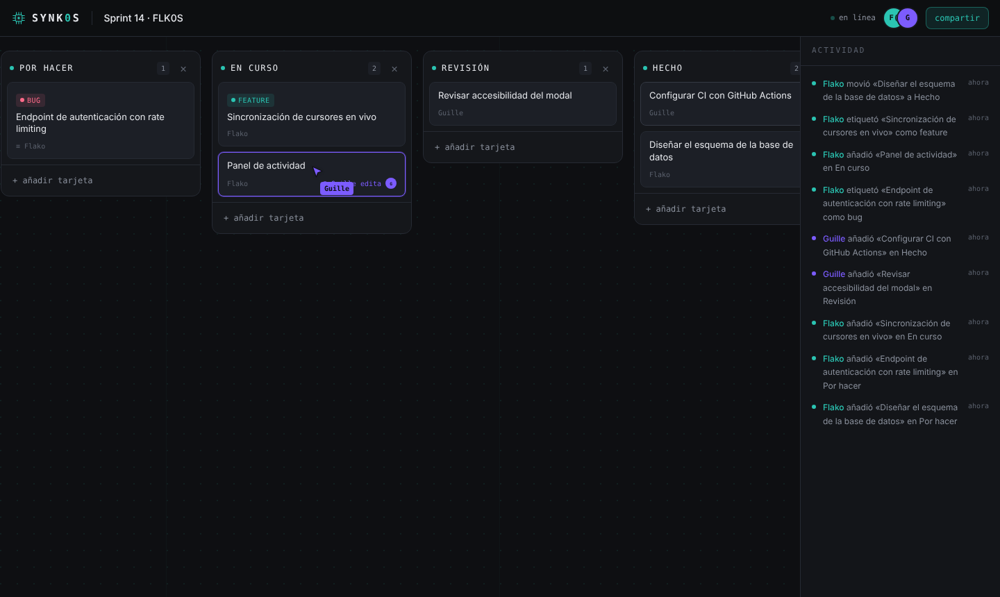

# SYNK0S — Kanban colaborativo en tiempo real

Tableros kanban donde varias personas trabajan a la vez: las tarjetas, columnas y etiquetas se sincronizan al instante, se ve quién está conectado, por dónde mueve el cursor y qué tarjeta está editando.

Sin registro: creas un tablero, compartes el enlace y a trabajar.

**Demo en vivo: [synk0s.onrender.com](https://synk0s.onrender.com)** (plan gratuito: la primera carga puede tardar unos 50 s en despertar)



## Funcionalidades

- **Sincronización en tiempo real** por WebSockets (Socket.IO), con actualizaciones optimistas en el cliente.
- **Presencia**: avatares de quién está dentro, cursores en vivo con nombre e indicador de "X edita" en cada tarjeta.
- **Drag & drop** de tarjetas entre columnas (dnd-kit), también con teclado.
- **Tarjetas** con título, descripción con autoguardado y etiquetas.
- **Columnas** editables: crear, renombrar con doble clic y borrar.
- **Feed de actividad** persistente: quién hizo qué y cuándo.
- **Persistencia** en SQLite con Drizzle ORM y migraciones versionadas.

## Stack

| Capa | Tecnología |
| --- | --- |
| Frontend | Next.js 15 (App Router), React 19, TypeScript, Tailwind CSS 4 |
| Tiempo real | Socket.IO sobre un servidor HTTP propio de Node |
| Datos | SQLite (better-sqlite3) + Drizzle ORM |
| Validación | Zod, compartido entre cliente y servidor |
| Tests | Vitest (unitarios + integración con clientes Socket.IO reales) |
| CI | GitHub Actions: typecheck, tests y build |

## Arquitectura

```
 Navegador A ─┐                         ┌─ board-service.ts ── SQLite
              ├─ WebSocket ── socket.ts ┤   (transacciones, filtrado por tablero)
 Navegador B ─┘   (Zod + rate limit)    └─ broadcast del patch a la sala del tablero
```

1. El cliente aplica el cambio en local al momento (UI optimista) y envía una **operación** (`card.move`, `column.rename`…).
2. El servidor la **valida con Zod**, comprueba que todo pertenece a ese tablero y la aplica en una **transacción**.
3. Difunde el **patch** resultante a toda la sala. Aplicar patches es idempotente (upsert por id), así que el eco del propio cambio no duplica nada.
4. Si el servidor rechaza la operación, el cliente vuelve a pedir el estado real y se resincroniza.

### Decisiones técnicas

- **Ordenación fraccional.** Cada tarjeta guarda un `position` decimal y al soltarla entre dos vecinas se usa el punto medio. Mover una tarjeta toca **una sola fila**, sin reescribir el orden de la columna.
- **IDs generados en el cliente** (nanoid, validados en servidor). Permite pintar la tarjeta antes de que responda el servidor sin "ids temporales".
- **Cursores por canal volátil.** Se envían a ~30 fps como mensajes `volatile`: si la red va lenta se descartan en vez de acumularse.
- **Servidor propio en lugar de las API routes de Next** porque los WebSockets necesitan una conexión persistente que el modelo serverless no ofrece.

## Seguridad

- Toda entrada del socket se valida con esquemas Zod: tipos, longitudes y rangos numéricos (sin `Infinity` ni `NaN`).
- **Anti-IDOR**: cada consulta filtra por `boardId`, así que conocer el id de una tarjeta de otro tablero no permite tocarla. Hay test que lo cubre.
- **Rate limiting** por conexión con token bucket (operaciones y cursores por separado).
- Mensajes limitados a 64 KB y límites de 12 columnas y 500 tarjetas por tablero.
- Cabeceras `X-Frame-Options`, `nosniff`, `Referrer-Policy` y `Permissions-Policy`.
- Los ids de tablero son aleatorios de 12 caracteres: el enlace funciona como capability URL.

## Arrancar en local

Requisitos: Node 20 o superior.

```bash
npm install
npm run dev
```

Abre <http://localhost:4747>, crea un tablero y ábrelo en otra ventana de incógnito para ver la colaboración. La base de datos se crea sola en `data/synk0s.db` al arrancar.

| Script | Qué hace |
| --- | --- |
| `npm run dev` | Servidor de desarrollo con recarga |
| `npm run build` y `npm start` | Build y servidor de producción |
| `npm test` | Tests unitarios y de integración |
| `npm run typecheck` | Comprobación de tipos |
| `npm run db:generate` | Genera una migración tras cambiar el esquema |

Variables de entorno opcionales: `PORT` (por defecto 4747), `HOST` y `DATABASE_FILE`.

## Despliegue

Necesita un host que mantenga conexiones WebSocket abiertas, así que no vale un entorno serverless como Vercel. El repo trae un `Dockerfile` y un blueprint de Render:

1. En [Render](https://render.com): **New → Blueprint** y elige este repositorio.
2. Render lee `render.yaml`, construye la imagen y publica la app en `https://synk0s.onrender.com` (o similar).

En el plan gratuito el disco no es persistente: los tableros se borran en cada redespliegue y la app se duerme tras 15 min sin visitas. Para datos permanentes, añade un disco persistente en `/app/data` o migra a PostgreSQL.

Con Docker en cualquier VPS:

```bash
docker build -t synk0s .
docker run -p 4747:4747 -v synk0s-data:/app/data synk0s
```

## Tests

```bash
npm test
```

17 tests, entre ellos:

- Integración con **dos clientes Socket.IO reales**: sincronización, presencia, cursores y rate limiting.
- Aislamiento entre tableros (IDOR), ids duplicados y borrado en cascada.
- Validación de entradas maliciosas y ordenación fraccional.

## Próximos pasos

- [ ] Cuentas de usuario y tableros privados con roles (lector / editor)
- [ ] Reordenar columnas con drag & drop
- [ ] Deshacer y rehacer
- [ ] PostgreSQL + adaptador Redis de Socket.IO para escalar a varias instancias
- [ ] Tests E2E con Playwright en CI
- [ ] Despliegue con Docker en un VPS

---

Hecho por [Samuel Fuentes · flk0s_](https://github.com/NotSaam) · Licencia MIT
